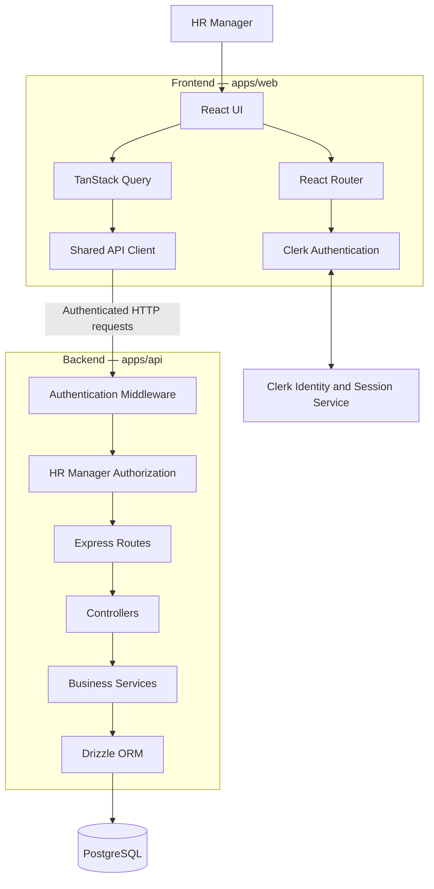
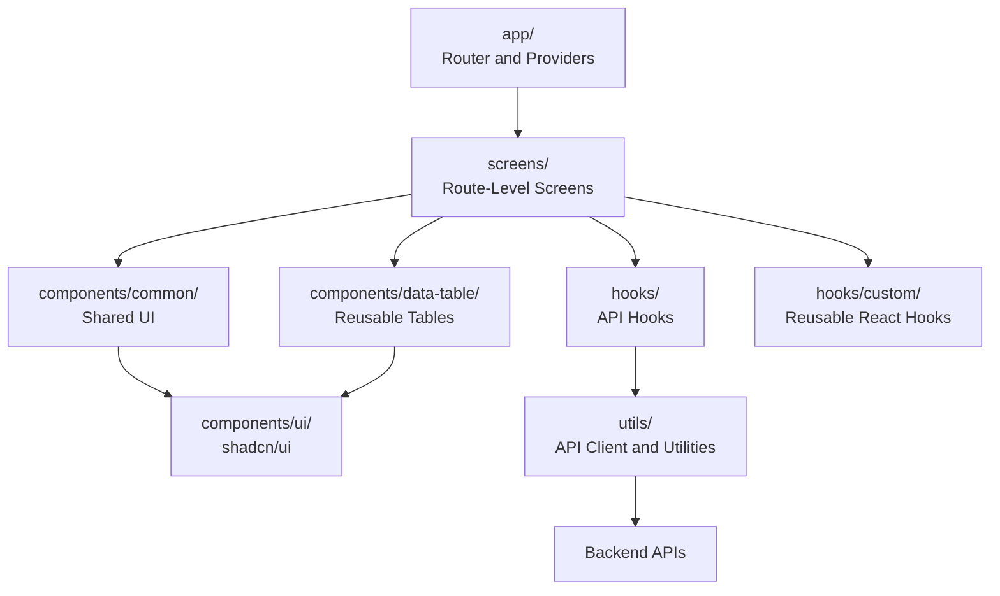
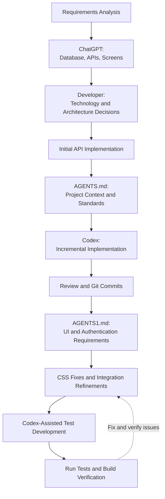

# AI-Assisted Development Workflow

## ACME Salary Management System

### 1. Overview

I developed the ACME Salary Management System using an AI-assisted engineering workflow that combined architectural planning, incremental code generation, manual implementation and refinement, version control, and automated testing.

I used ChatGPT during the initial planning and design phase to help evaluate database design, API requirements, and application screens. After deciding on the technology stack and architecture, I implemented some initial APIs with ChatGPT's assistance.

I then used OpenAI Codex as my primary coding agent. To ensure consistent implementation, I created instruction files that defined the project context, technology stack, folder structure, architectural decisions, coding standards, and implementation steps. Codex followed these instructions to generate code incrementally, allowing me to review and commit changes at each stage.

After the core implementation, I refined the UI, resolved CSS and integration issues, implemented authentication and authorization, and used Codex to write and validate test cases.

The objective was not simply to generate code using AI, but to use AI as an engineering assistant while retaining responsibility for technical decisions, code review, integration, and quality.

### 2. Phase 1 — Requirement Analysis and Initial Design Using ChatGPT

I started by using ChatGPT to understand the requirements of the ACME Salary Management System and break the problem into manageable technical components.

The initial discussions focused on:

- Understanding the business requirements and identifying the core features.
- Designing the database schema for employee and salary management.
- Identifying relationships, constraints, and indexes needed for the database.
- Defining the API operations required by the application.
- Identifying the main application screens, including the Dashboard, Employee Directory, Employee Details, and Analytics pages.
- Understanding how employee records, salary history, and compensation analytics should work together.

ChatGPT helped me explore the design options and reason about the relationships between the database, backend APIs, and frontend screens.

I reviewed these suggestions and used them to establish the initial technical direction of the application.

### 3. Phase 2 — Technology Selection and Architecture Decisions

After the initial design discussions, I made the technology-stack and architecture decisions for the project.

The selected stack included:

- **Frontend:** React, TypeScript, Vite, Tailwind CSS, shadcn/ui, React Router, and TanStack Query.
- **Backend:** Node.js, Express, and TypeScript.
- **Database:** PostgreSQL with Drizzle ORM.
- **Validation:** Zod.
- **Monorepo:** Turborepo with npm workspaces.
- **Authentication:** Clerk, for email OTP authentication and HR Manager authorization.

I chose the architecture and folder organization to keep the application maintainable and separate responsibilities between the frontend, backend, database, and shared utilities.

I also established important business rules, including salary-history preservation, server-side pagination, input validation, and currency-specific compensation analytics.

I used ChatGPT to help implement some initial APIs and refine the database and API design. These initial implementations provided a foundation for the subsequent development work.

The technology choices and architecture remained my responsibility; AI suggestions were used as input into the decisions rather than accepted automatically.

### 4. Phase 3 — Creating AGENTS.md for Codex

Once the initial architecture and backend foundation were established, I moved the implementation workflow to OpenAI Codex.

Before asking Codex to generate substantial amounts of code, I created an `AGENTS.md` instruction file.

The purpose of this file was to give the coding agent a consistent source of project context and implementation guidance.

The instructions described:

- The project requirements and business rules.
- The selected technology stack.
- The expected folder structure.
- Responsibilities of different modules and components.
- API implementation and integration conventions.
- Coding standards and TypeScript expectations.
- Validation and error-handling requirements.
- Testing expectations.
- The sequence of implementation steps.
- The requirement to inspect existing code and preserve working functionality.

This approach reduced the need to repeatedly explain the architecture and helped Codex work within the intended project structure.

Instead of asking Codex to build the entire application in a single request, I instructed it to implement the system in smaller, clearly defined stages.

### 5. Phase 4 — Incremental Implementation Using Codex

Codex used the instructions in `AGENTS.md` to implement the application incrementally.

The workflow involved implementing a logical unit of functionality, reviewing the resulting changes, and verifying the implementation before moving to the next stage.

The implementation work included:

- Developing and refining backend functionality.
- Implementing database integration using Drizzle ORM.
- Adding request validation and error handling.
- Building frontend components and application screens.
- Integrating the frontend with the backend APIs.
- Implementing reusable API hooks and shared UI components.
- Improving the separation of responsibilities across the codebase.

I reviewed the generated code and checked how each change fit into the existing implementation.

I also committed changes to Git in stages rather than waiting until the entire application was complete. This maintained a history of the implementation and made individual changes easier to review, trace, and troubleshoot.

This incremental approach helped limit the scope of individual changes and reduced the risk of introducing widespread regressions.

### 6. Phase 5 — Refinement and Authentication Using AGENTS1.md

After the initial frontend and backend functionality was implemented, I identified additional requirements related to UI refinement, authentication, and authorization.

Rather than continuing with an increasingly large set of ad hoc instructions, I created a second instruction file, `AGENTS1.md`.

This file described the additional requirements, the relevant architecture, implementation steps, and expectations for integrating the new functionality with the existing application.

The next development phase focused on:

- Improving the Dashboard and Analytics pages.
- Presenting analytical information through suitable charts and visualizations.
- Refining the existing UI while preserving the application structure.
- Integrating Clerk authentication using email OTP.
- Restricting protected application pages and API endpoints to authorized HR Managers.
- Implementing authentication and authorization middleware in the backend.
- Handling unauthorized access and expired sessions.
- Creating an unauthorized-access page with a route back to sign-in.
- Maintaining consistent error handling between the frontend and backend.

Codex followed the second set of instructions to implement these changes in stages.

I reviewed the integration with the existing code and addressed issues encountered during implementation.

The two instruction files served different purposes: the initial instructions guided the core application development, while the second set focused on subsequent UI, authentication, and authorization improvements.

### 7. Phase 6 — Manual UI Refinement and Bug Fixes

After the main functionality was implemented, I performed additional refinement work.

AI-generated code required verification and adjustment to work correctly with the existing project configuration and UI behavior.

I fixed CSS and layout issues, refined component behavior, and resolved other issues discovered during integration and testing.

This phase included checking that the application screens displayed correctly, that components behaved consistently, and that the frontend interacted correctly with the backend.

I treated generated code as a starting point for implementation rather than assuming it was correct simply because it compiled or appeared complete.

Where problems arose, I investigated the underlying cause, adjusted the implementation, and verified the result.

### 8. Phase 7 — AI-Assisted Test Development

Once the main functionality and refinements were in place, I used Codex to help write test cases.

I used the coding agent to identify important behaviors and translate them into tests, including validation, API behavior, and critical application workflows.

The testing work focused on areas such as:

- Request validation.
- Employee search, filtering, sorting, and pagination.
- API error handling.
- Salary validation and data-integrity rules.
- Authentication and authorization behavior.
- Protected route behavior.
- Analytics rendering and data presentation.
- Important UI states and user interactions.

I reviewed the generated tests and ran the available testing and verification commands to assess the implementation.

The purpose of this phase was to improve confidence in the application and catch regressions, rather than treating successful code generation as evidence of correctness.

AI assistance accelerated test creation, while test execution and result review remained important parts of the workflow.

### 9. Phase 8 — Git-Based Change Management

Throughout development, I used Git to maintain incremental commits.

I committed changes after completing logical implementation stages, rather than accumulating all changes into one final commit.

This provided several benefits:

- A clear history of development decisions.
- Easier identification of when a problem was introduced.
- Smaller changes that were easier to review.
- Better traceability between implementation stages and their outcomes.
- A more controlled way to integrate refinements and fixes.

The Git history complemented the instruction files by providing a record of how the implementation evolved over time.

### 10. Overall AI-Assisted Workflow

The overall process can be summarized as follows:

1. **Requirements and design:** Used ChatGPT to explore the requirements, database schema, API needs, and application screens.
2. **Technical decisions:** Selected the technology stack and application architecture.
3. **Initial implementation:** Used ChatGPT to assist with some initial API development.
4. **Agent instructions:** Created `AGENTS.md` to define project context, architecture, coding standards, and implementation stages.
5. **Incremental coding:** Used Codex to implement the application in manageable steps.
6. **Version control:** Reviewed and committed changes throughout development.
7. **Additional requirements:** Created `AGENTS1.md` to guide UI improvements and Clerk authentication and authorization.
8. **Refinement:** Fixed CSS, layout, integration, and other implementation issues.
9. **Testing:** Used Codex to help write tests and reviewed the results.
10. **Verification:** Checked the implementation through available type-checking, testing, and build workflows.

### 11. System Architecture and Architecture Diagrams

I designed the ACME Salary Management System as a modular application within a Turborepo monorepo. The frontend and backend are separate applications with clearly defined responsibilities, while PostgreSQL serves as the persistent data store.

The architecture was planned during the initial design phase with ChatGPT and refined during implementation using Codex. I defined the technology stack, module responsibilities, and folder structure before asking Codex to generate the implementation incrementally.

#### 11.1 High-Level System Architecture

The following diagram illustrates the intended request flow between the user interface, authentication, backend APIs, and database.

The main architectural responsibilities are:

- **Frontend:** Presents employee information, salary history, dashboards, and analytics.
- **Clerk:** Handles identity verification and session management.
- **API client:** Centralizes HTTP requests and authentication-token integration.
- **Authentication middleware:** Verifies the user's authentication context.
- **Authorization middleware:** Ensures that only users with the required HR Manager role can access protected APIs.
- **Express controllers and services:** Separate HTTP handling from business logic.
- **Drizzle ORM:** Provides typed database operations.
- **PostgreSQL:** Stores employee and salary information and enforces database-level constraints.

Authentication and authorization must be enforced by the backend independently of frontend route protection. The frontend guard improves navigation and user experience but is not a substitute for API security.

#### 11.2 Frontend Architecture

The frontend follows a responsibility-based folder structure.

This structure separates route-level composition, shared presentation, API access, reusable React behavior, and framework-independent utilities.

The generic API hooks centralize request behavior, while domain-specific hooks expose operations relevant to employees, salaries, and analytics. This reduces duplicated request logic across screens.

#### 11.3 AI-Assisted Development Workflow

The development process itself followed a structured workflow.

The workflow used persistent agent instructions and incremental implementation rather than relying on one large prompt. Git commits provided checkpoints throughout development, and testing was used to verify behavior after implementation.

### 12. Architectural Trade-Offs and Design Decisions

During development, I considered the trade-offs between implementation simplicity, maintainability, security, and performance.

| Decision                            | Benefit                                                                             | Trade-off or limitation                                                                             |
| ----------------------------------- | ----------------------------------------------------------------------------------- | --------------------------------------------------------------------------------------------------- |
| Turborepo monorepo                  | Keeps frontend and backend in one repository and simplifies coordinated development | Requires clear workspace boundaries and dependency management                                       |
| React with TypeScript               | Improves component reuse and catches many errors during development                 | Requires additional type definitions and configuration                                              |
| Express                             | Lightweight and flexible for API development                                        | Requires deliberate organization of routing, validation, and error handling                         |
| PostgreSQL                          | Supports relational integrity, transactions, and structured analytics               | Requires schema management, migrations, and query optimization                                      |
| Drizzle ORM                         | Provides typed database access and schema-oriented development                      | Complex queries may require careful SQL-level reasoning and inspection                              |
| TanStack Query                      | Centralizes server-state caching, loading states, and invalidation                  | Incorrect query keys or invalidation rules can cause stale or duplicated data                       |
| Shared API hooks                    | Reduce repeated request logic and standardize API integration                       | Overly generic wrappers can obscure endpoint-specific behavior if poorly designed                   |
| shadcn/ui and Tailwind CSS          | Support consistent styling and reusable UI primitives                               | Require discipline to maintain consistent design conventions                                        |
| Clerk authentication                | Delegates identity verification and session management to a dedicated service       | Introduces an external service dependency and requires correct configuration                        |
| Backend role-based authorization    | Enforces permissions even when requests bypass the frontend                         | Requires role verification and consistent middleware coverage across protected endpoints            |
| Incremental AI-assisted development | Makes changes easier to review and troubleshoot                                     | Requires maintaining context, reviewing generated code, and managing multiple implementation stages |
| Server-side pagination              | Limits the data transferred and rendered per request                                | Requires pagination-aware API contracts and additional requests to navigate results                 |

#### 12.1 Why I Chose Incremental AI-Assisted Development

One alternative was to ask an AI coding agent to generate the entire application in one large operation. I chose a staged approach instead.

Smaller implementation steps made it easier to:

- Review the code generated by Codex.
- Detect architectural deviations early.
- Keep changes aligned with the existing repository.
- Commit completed units of work.
- Isolate regressions.
- Update instructions when requirements evolved.

The trade-off was that implementation required more coordination and review. However, this approach offered better control over code quality and integration.

#### 12.2 Why Authentication and Authorization Are Separate

Authentication establishes the identity of the user, while authorization determines whether that user can perform a protected operation.

Clerk provides the authentication and session infrastructure. The backend independently verifies the authentication context and checks the HR Manager role before allowing protected operations.

This separation avoids treating a signed-in user as automatically authorized to access employee and salary information.

#### 12.3 Why Currency-Specific Analytics Matter

A single compensation total combining INR, USD, and SAR would be misleading without a defined conversion policy.

The application therefore keeps compensation analytics separated by currency. This prioritizes the correctness of financial information over presenting a single, superficially convenient aggregate.

#### 12.4 Why I Used Centralized API Hooks

Writing request logic independently in every screen would increase duplication and make error handling and caching behavior inconsistent.

The generic API hooks provide shared request behavior, while domain-specific hooks organize employee, salary, and analytics operations. This adds a small abstraction layer but improves consistency and maintainability.

### 13. Performance Optimization and Scalability

Performance was considered in both the application architecture and the implementation workflow. The objective was to support the assessment's approximately 10,000 employee records without loading unnecessary data or performing expensive work in the browser.

The following practices describe the performance approach and the areas to verify in the final implementation.

#### 13.1 Database and API Performance

**Server-side pagination**

The employee directory retrieves a limited page of results instead of downloading all employee records.

This reduces response size, network transfer, and frontend rendering work.

**Database-side filtering and sorting**

Search, filters, sorting, and pagination should be performed by PostgreSQL rather than by downloading a large dataset and processing it in the browser.

**Indexes**

Indexes should support common access patterns, such as employee identifiers, unique employee codes and emails, employment status, and frequently used filtering combinations.

Indexes must be selected based on actual queries and query plans because additional indexes also increase storage and write costs.

**Efficient queries**

The backend should select only the required columns, avoid unnecessary repeated queries, and use database-side aggregation for dashboard and analytics data where appropriate.

**Transactions**

Salary updates involving multiple related database changes should use transactions where atomicity is required. This protects data integrity without requiring separate compensating operations after partial failures.

#### 13.2 Frontend Performance

**TanStack Query caching**

The application uses TanStack Query to manage server-state caching and reduce unnecessary refetching.

Stable query keys must include the relevant parameters, such as page number, page size, filters, and sorting. Successful mutations should invalidate only the queries affected by the change.

**Lazy-loaded screens**

React Router lazy loading allows major screens, such as Dashboard, Employees, Employee Details, and Analytics, to be loaded when needed rather than including all screen code in the initial bundle.

**Debounced search**

Debouncing prevents a new API request from being triggered for every keystroke while the user is typing. The request is issued after a short pause, reducing unnecessary network and database activity.

**Reusable components**

Shared UI and data-table components reduce duplicated implementation and help maintain consistent behavior. Reuse should remain purposeful; abstraction alone does not guarantee better runtime performance.

**Responsive chart rendering**

Charts should use responsive containers and avoid rendering unnecessarily large datasets. When detailed analytics require substantial aggregation, the backend should provide appropriately summarized results.

#### 13.3 Analytics Performance

Dashboard and analytics screens should request only the information they need.

The backend should aggregate counts, averages, and category distributions in PostgreSQL when appropriate, instead of returning all employee and salary records for calculations in the browser.

Additional considerations include:

- Avoiding duplicate API requests for the same dataset.
- Using suitable caching policies for relatively stable analytics.
- Separating compensation aggregations by currency.
- Avoiding unnecessary chart animations and expensive rendering.
- Handling empty datasets without repeated requests.
- Applying appropriate limits to detailed result sets.

Caching must not cause sensitive salary data to remain visible after a user signs out or loses access. Authentication and authorization take priority over cache reuse.

#### 13.4 Authentication Performance and Reliability

Authentication checks should use Clerk's supported session and token mechanisms.

The frontend should use reactive authentication state and avoid unnecessary repeated role lookups. The backend must nevertheless validate protected requests independently.

Session-expiration handling must not rely solely on a frontend timer. The server must reject expired or invalid credentials, even when a browser tab remains open or client-side timers are delayed.

#### 13.5 Performance Verification

Performance improvements should be verified rather than assumed.

The following checks can be used to evaluate the implementation:

- Inspect SQL queries and PostgreSQL query plans for expensive employee and analytics operations.
- Confirm that employee requests return only the requested page.
- Verify that filters and sorting are applied by the backend.
- Check that analytics endpoints return aggregated data rather than unnecessarily large datasets.
- Inspect the frontend production bundle for lazy-loaded routes.
- Verify that search debouncing reduces unnecessary requests.
- Confirm that TanStack Query invalidation does not trigger excessive refetching.
- Test loading behavior with realistic seeded data.
- Measure request latency and rendering behavior when practical.

Only report an optimization as completed if the relevant implementation exists and has been verified.

### 14. Engineering Learnings from Architecture and Performance Work

The architectural and performance considerations reinforced several lessons.

First, the data model and API contract strongly influence the performance and correctness of the frontend. Efficient pagination and accurate analytics are difficult to achieve if the backend returns unnecessarily large or ambiguous datasets.

Second, maintainability and performance are related but distinct. Reusable components and API hooks improve consistency, while database indexes, query plans, caching policies, and bundle analysis address specific performance concerns.

Third, security decisions affect application behavior beyond the login page. Protected API requests, session expiration, role checks, and cached data must be considered together.

Finally, AI-assisted development benefits from explicit constraints. By documenting the architecture and implementation stages, I could guide Codex toward changes that fit the existing system rather than repeatedly generating alternative structures.

These considerations helped me approach the project as an integrated software system rather than a collection of independently generated screens and APIs.

### 15. Key Learnings

This project demonstrated that effective AI-assisted software development requires more than good prompts.

The most useful practices were:

- **Providing persistent context:** Instruction files helped the coding agent understand the project's architecture and constraints.
- **Making architectural decisions early:** Defining the stack and folder structure before large-scale code generation reduced unnecessary structural changes.
- **Working incrementally:** Smaller implementation stages made the generated code easier to review and debug.
- **Maintaining version control:** Incremental commits created a traceable development history.
- **Reviewing AI-generated code:** Generated implementations still required validation, integration, and refinement.
- **Testing behavior:** Tests provided a way to evaluate correctness beyond visual inspection or successful compilation.
- **Keeping ownership of engineering decisions:** AI assisted with design exploration and implementation, while I remained responsible for selecting the architecture, reviewing changes, resolving issues, and verifying the outcome.

### 16. Conclusion

I used ChatGPT and OpenAI Codex at different stages of the ACME Salary Management System development process.

ChatGPT supported the early design phase, including database planning, API requirements, screen identification, and initial API implementation. Codex then supported structured, incremental development using explicit project instructions in `AGENTS.md` and `AGENTS1.md`.

I combined this AI-assisted workflow with architectural decisions, staged Git commits, manual UI and integration fixes, and AI-assisted test development.

The main benefit was a structured way to accelerate implementation while preserving maintainability, traceability, and engineering oversight.

The experience reinforced that AI coding agents are most effective when they operate within clear architectural boundaries, receive specific implementation instructions, and are paired with code review and verification.
